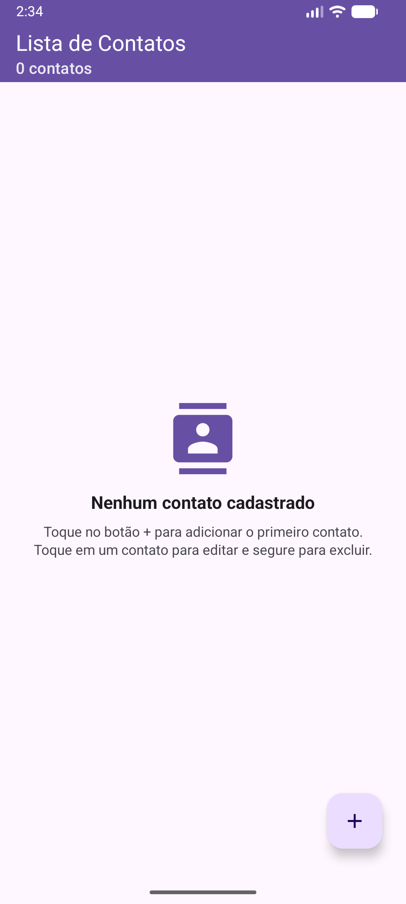
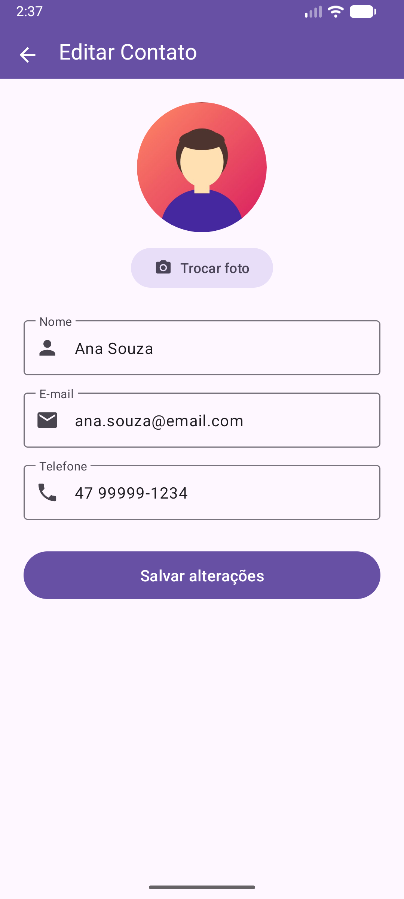
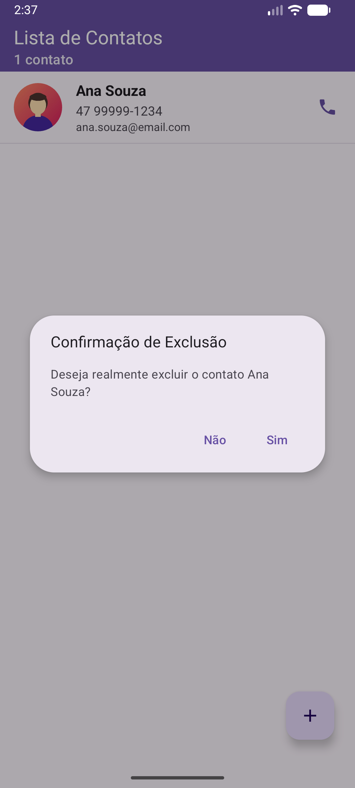

# Agenda — CRUD de contatos com SQLite (MVC)

Aplicação Android nativa em **Java** para gerenciar contatos pessoais: criar, listar, editar e excluir contatos com **nome, e-mail, telefone e foto**. Os dados ficam salvos em um banco **SQLite** no próprio dispositivo.

Projeto da disciplina **Programação para Dispositivos Móveis**: persistência de dados estruturados e comunicação entre processos.

## 🎬 Vídeo do app rodando

[▶️ Assistir à demonstração (docs/demo.mp4)](docs/demo.mp4). Mostra o cadastro de 3 contatos, a validação, a edição, a exclusão, a ligação e os dados mantidos depois de fechar e abrir o app.

## 📱 Telas

| Lista vazia | Novo contato | Lista de contatos |
|:---:|:---:|:---:|
|  |  |  |

| Editar (clique) | Excluir (clique longo) | Ligar (Intent implícita) |
|:---:|:---:|:---:|
|  |  |  |

