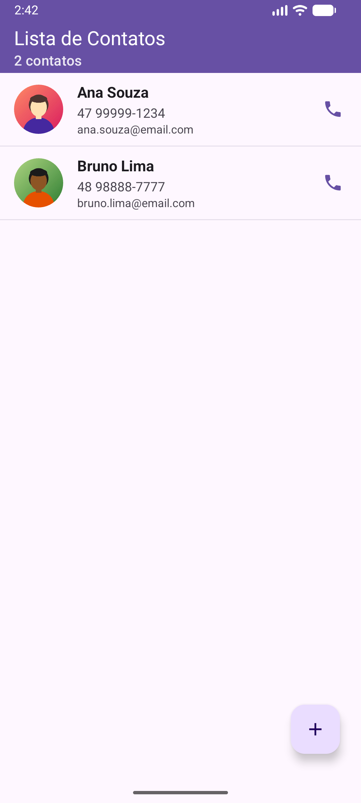
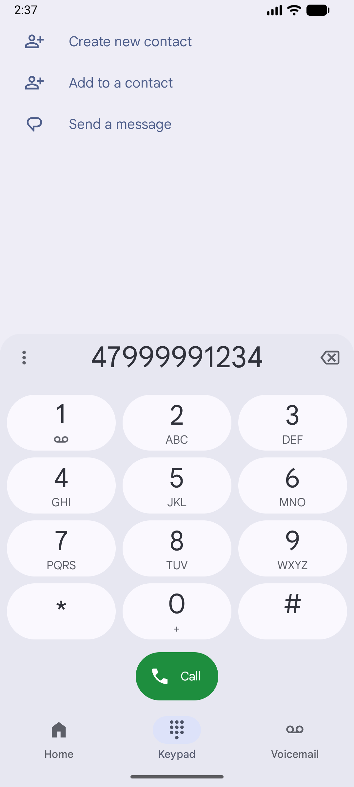

# Agenda — CRUD de contatos com SQLite (MVC)

Aplicação Android nativa em **Java** para gerenciar contatos pessoais: criar, listar, editar e excluir contatos com **nome, e-mail, telefone e foto**. Os dados ficam salvos em um banco **SQLite** no próprio dispositivo.

Projeto da disciplina **Programação para Dispositivos Móveis**: persistência de dados estruturados e comunicação entre processos.

## 🎬 Vídeo do app rodando

[▶️ Assistir à demonstração (docs/demo.mp4)](docs/demo.mp4). Mostra o cadastro de 3 contatos, a validação, a edição, a exclusão, a ligação e os dados mantidos depois de fechar e abrir o app.

## 📱 Telas

| Lista vazia | Novo contato | Lista de contatos |
|:---:|:---:|:---:|
|  |  |  |

| Editar (clique) | Excluir (clique longo) | Ligar (Intent implícita) |
|:---:|:---:|:---:|
|  |  |  |

## 🧱 Arquitetura MVC

```
app/src/main/java/com/example/agenda/
├── model/                        # Camada de Dados
│   ├── Contato.java              # Entidade (Bean, Serializable)
│   ├── DatabaseHelper.java       # SQLiteOpenHelper: criação e versionamento (migrations)
│   └── ContatoDAO.java           # Operações de banco (CRUD)
├── controller/                   # Camada de Negócio
│   └── ContatoController.java    # Regras de negócio; intermedia View e Model
├── util/
│   └── FotoUtil.java             # Salva/carrega fotos no armazenamento interno do app
├── MainActivity.java             # View: lista de contatos (ListView + ArrayAdapter)
└── AdicionarContatoActivity.java # View: formulário de inclusão e alteração
```

**Fluxo:** Activity (View) → `ContatoController` → `ContatoDAO` → `DatabaseHelper` → SQLite. O resultado volta como objetos `Contato`.

| Operação | DAO | Disparada por |
|---|---|---|
| **Create** | `adicionarContato()` | Botão **+** → formulário vazio → Salvar |
| **Read** | `listarContatos()`, `buscaContatoPorId()` | Ao abrir/voltar para a lista (`onResume`) |
| **Update** | `atualizarContato()` | **Clique** no contato → formulário preenchido → Salvar alterações |
| **Delete** | `apagarContato()` | **Clique longo** no contato → confirmação → Sim |

## ✨ Detalhes da implementação

- **SQLite** com `SQLiteOpenHelper`, `DB_VERSION = 2` e *migration* no `onUpgrade()` (adiciona a coluna `foto` sem apagar os dados).
- **SQL parametrizado** (`"id=?"`) e nomes de tabela/colunas como constantes.
- **Validação no Controller**: nome e telefone são obrigatórios, e o e-mail, quando preenchido, precisa ser válido.
- **Foto do contato**: vem da galeria (Photo Picker, sem permissão de armazenamento) ou da câmera. É copiada para o *app-specific storage* (`files/fotos`), e no banco fica só o caminho do arquivo. Quando o contato é excluído ou a foto é trocada, o arquivo antigo é apagado.
- **Comunicação entre componentes/apps (IPC)**:
  - *Intent explícita* com extra `Serializable` para abrir o formulário de edição;
  - *Intent implícita* `ACTION_DIAL` para ligar (abre o discador);
  - *Intent implícita* para o app de câmera (`TakePicturePreview`).
- Telefone formatado no padrão brasileiro durante a digitação; contatos sem foto mostram as iniciais em um círculo colorido.

## ▶️ Como executar

1. Abra a pasta do projeto no **Android Studio** (*File → Open*) e aguarde a sincronização do Gradle.
2. Selecione um emulador ou celular e clique em **Run ▶**.

Requisitos: Android Studio recente (AGP 9.5), `compileSdk`/`targetSdk` 37, `minSdk` 26.
